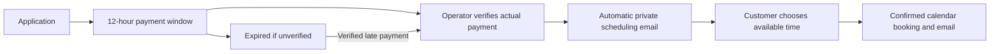

# Customer Journey Operations

**Paid freelance project — a deployed customer and operator workflow for a coaching business.**

Delivered for a paying client, this project connects application intake, human payment verification, private scheduling, notifications, and operational recovery. This repository contains a sanitized source snapshot: live accounts, customer records, credentials, deployment identifiers, proprietary attachments, and production logs are excluded.

[한국어 프로젝트 소개](docs/PROJECT.ko.md) · [Architecture and trade-offs](docs/ARCHITECTURE.md) · [Setup](docs/SETUP.md) · [Validation](docs/VALIDATION.md)

## The business problem

A coaching operator needed to accept applications without allowing unpaid applicants to occupy limited coach time, confirm real payments before scheduling, and keep email, calendars, and an operations database aligned. Operators also needed a safe way to recover failed notifications and remove their own test applications.

## The resulting customer journey



**Payment is not processed by this application.** A customer pays through an external payment page; an operator explicitly attests to checking the payment. The scheduling email is then sent automatically. No payment gateway webhook or automatic bank reconciliation is claimed.

## Delivered capabilities

| Capability | Evidence in this repository |
| --- | --- |
| Requirements translated into operating rules | Payment-first state transitions; 12-hour deadline; late-payment recovery |
| Customer and operator journey design | Responsive applicant flow, private scheduling, admin status filters and explicit confirmation actions |
| Service integration | Signed Apps Script bridge, Google Calendar/Mail/Drive, Notion API |
| Operational reliability | Stable application IDs, locking, retry controls, sync leases, and review states for ambiguous delivery |
| Safe post-launch improvements | Test deletion validates identity, releases associated calendar reservations, archives Notion pages, and retains an audit |
| Delivery and enablement | Automated regression scenarios, production integration verification, operator procedures and rollout lessons |

## Run locally

Use Node.js 22 or later.

```sh
cd mockup
npm ci
npm test
npm run typecheck
npm run build
npm run dev
```

The development command starts the **frontend preview**. It does not emulate Vercel serverless routes or Google services. Full integration requires your own isolated service configuration; see [Setup](docs/SETUP.md). Tests use in-memory providers and require no live credentials.

## Repository map

- `mockup/` — React/TypeScript frontend and authored serverless handlers. The folder name is inherited; it contains the source from the deployed implementation, not merely screen mockups.
- `integrations/WebsiteMail.gs` — integrated Google Apps Script receiver and booking backend.
- `integrations/booking-v2.gs` — separately maintained booking logic used by regression tests; its implementation also appears inside the integrated receiver.
- `tests/` — isolated state-machine, authorization, notification, recovery, and cleanup scenarios.
- `scripts/` — test runner and serverless bundling.
- `docs/` — project context, architecture, setup, validation, and interview framing.

## Delivery scope

This paid freelance engagement covered operating requirements, customer and operator workflows, Google/Notion integrations, UAT, deployment, operator guidance, and post-launch corrections. AI coding assistance was used during implementation.

The solution was delivered for a small-business operating context with a spreadsheet-backed store. Payment verification is manual, test deletion retains an audit, and privacy retention requires an operating process. Enterprise load capacity and quantitative business impact have not been benchmarked.

Production integration checks and this public snapshot's local regression/build checks are documented separately in [Validation](docs/VALIDATION.md). The public repository uses placeholders and does not expose the client's backend or customer data.

The project demonstrates transferable delivery skills for implementation, managed services, solution consulting, customer operations, and technical customer success.
